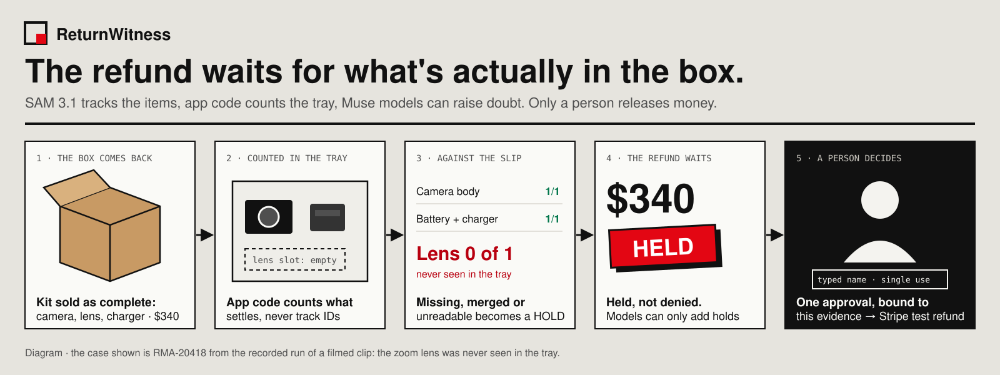
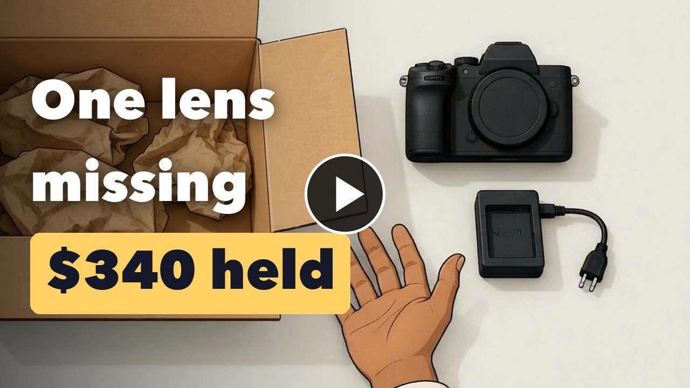
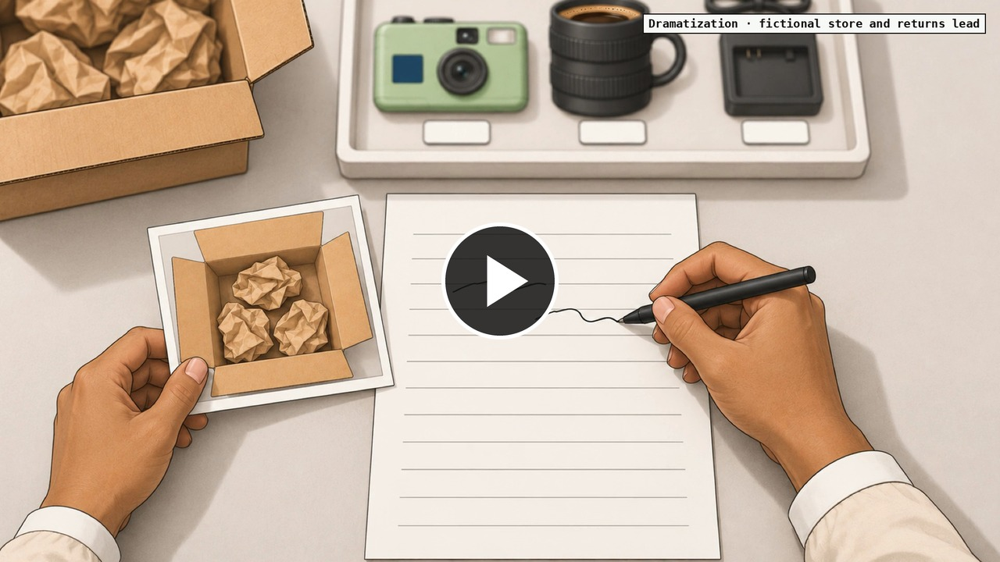
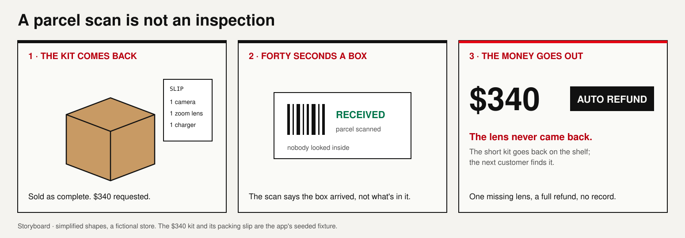
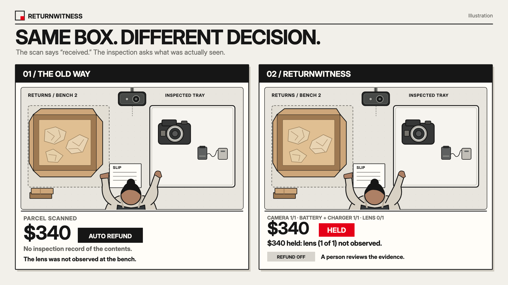
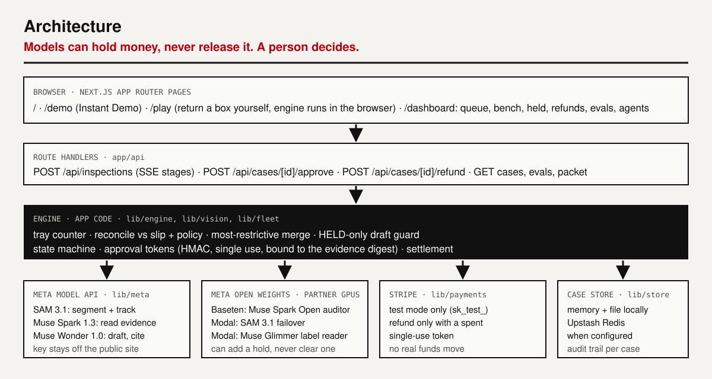
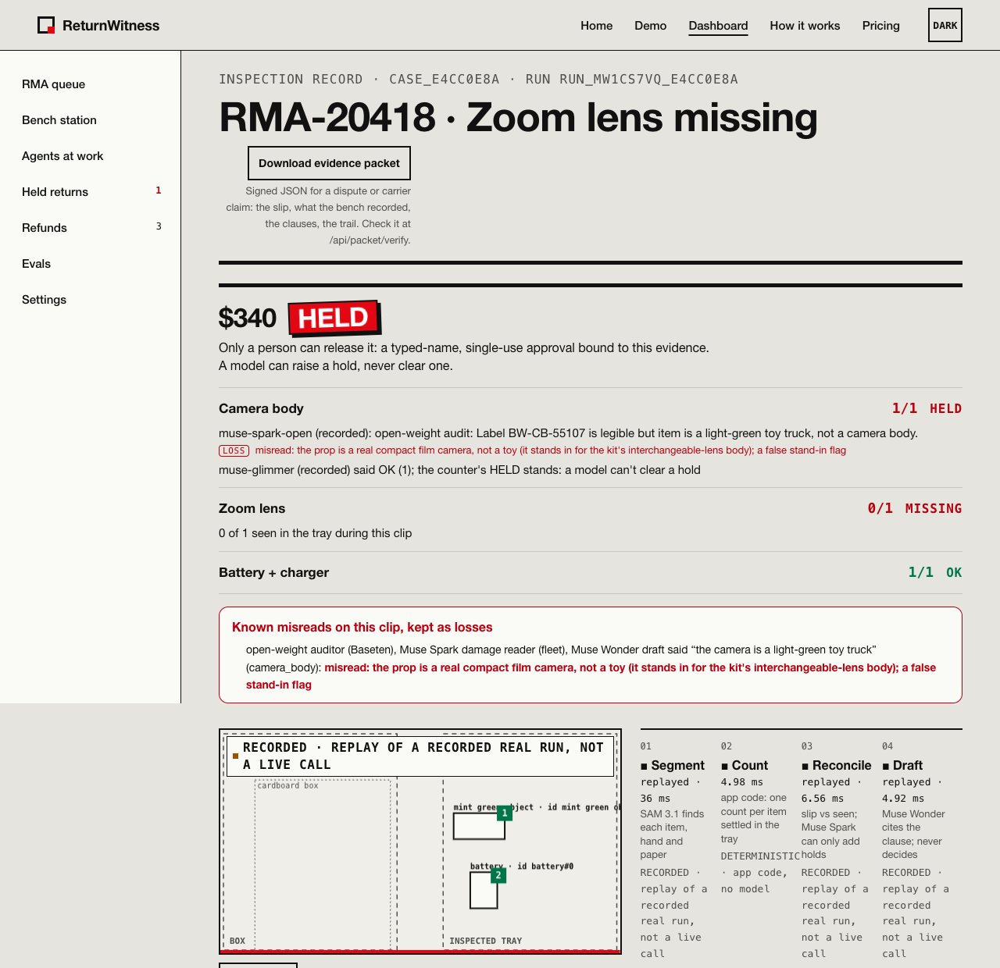
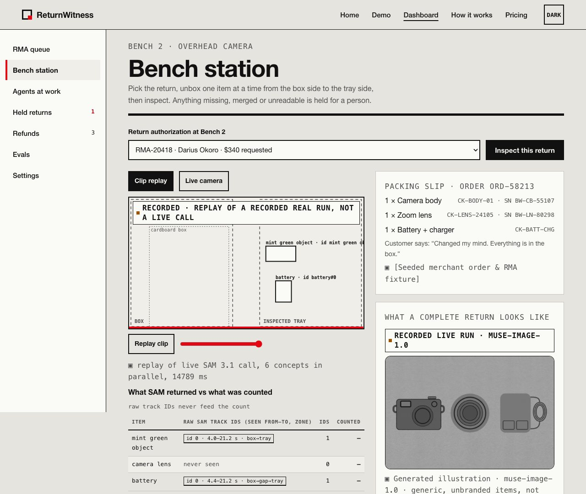
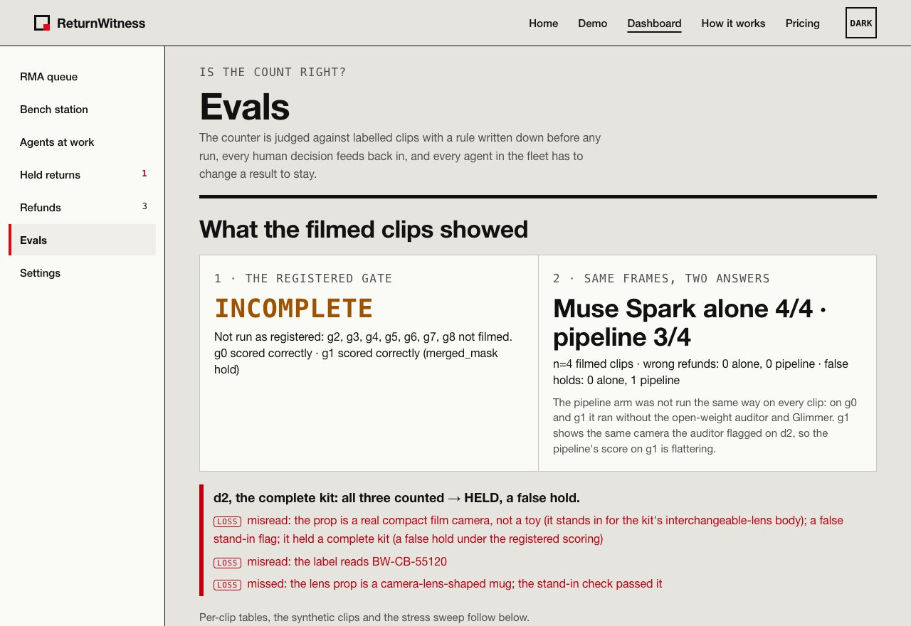
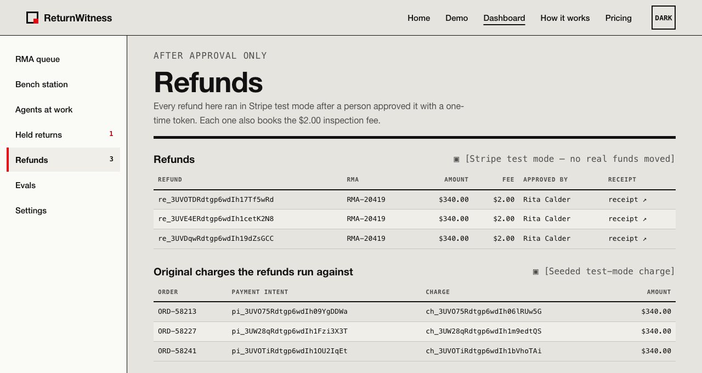

# ReturnWitness



**The refund waits for what's actually in the box.**

**Live site: https://returnwitness.vercel.app** · start at **[/demo](https://returnwitness.vercel.app/demo)** (Instant Demo: one return held for a missing lens, one complete return approved by a person) or **[/play](https://returnwitness.vercel.app/play)** (return a box yourself; [/play/walker](https://returnwitness.vercel.app/play/walker) runs the same engine at a loan closet).

## Watch
| [](https://youtu.be/Jg2yhBP1V44) | [](https://x.com/AgentGlassInc/status/2117756839328968900) |
|:---:|:---:|
| **[Demo · 3 min ▶](https://youtu.be/Jg2yhBP1V44)** | **[Story film, illustrated · on X ▶](https://x.com/AgentGlassInc/status/2117756839328968900)** |

**[▶ Watch the demo on YouTube](https://youtu.be/Jg2yhBP1V44)** &nbsp; [](https://youtu.be/Jg2yhBP1V44)

**On X:** [the demo post](https://x.com/SidraMiconi/status/2117756371097837610) · [AgentGlass, story film](https://x.com/AgentGlassInc/status/2117756839328968900)





<sub>Illustration: a fictional store and customer, drawn, not footage. Real screenshots are below.</sub>



<sub>Illustration, not a ReturnWitness screenshot.</sub>

For a returns lead at an online store that ships multi-item kits, who can't tell at the bench whether a returned box is complete, ReturnWitness films the unboxing under a fixed overhead camera, counts what came back against the packing slip, and holds the refund until a person approves. A $340 return with a missing lens never refunds by itself.

**Meta's models are the engine.** SAM 3.1 supplies the evidence (every item, hand and paper, tracked frame by frame), Muse Spark 1.3 reads it a second way, and Muse Wonder 1.0 drafts the decision against the policy. Take SAM 3.1 away and there is nothing to count; the app can only replay a labelled recording.

By Sidra Miconi · [@SidraMiconi](https://x.com/SidraMiconi)

## At a glance

**SAM 3.1 tracks what comes out of a returned box. App code counts what settles in the tray. Models can raise a hold, never clear one. A person releases the money.**

### The problem

A returned kit can be scanned as received and refunded in full while a part is still missing.

At the returns bench a box gets seconds, and a parcel scan says the box arrived, not what was inside it. A $340 camera kit can come back without its $109 lens and refund in full; the short kit goes back on the shelf, and there is no record of what was actually seen.

**ReturnWitness makes the refund wait for evidence of what came back, and makes a person, not a model, the one who releases it.**

### The solution: Film → Count → Reconcile → Hold → Person

**1. Film.** A fixed overhead camera films the unboxing, table only.

**2. Count.** SAM 3.1 segments and tracks every item, hand and piece of packing paper. App code counts an item once it settles in the inspected tray, never from track IDs, so a hand covering an item or a re-issued ID can't add a second count.

**3. Reconcile.** The count is checked against the packing slip and the store's policy. Muse Spark 1.3, Muse Spark Open (on Baseten) and Muse Glimmer (on Modal) read the same evidence (serial labels, damage, stand-ins) and can only add holds.

**4. Hold.** Anything missing, merged, unreadable or disputed becomes a HOLD. Muse Wonder 1.0 drafts the decision, cites the policy clause, and can only move a case toward HELD.

**5. Person.** A person reads the evidence and approves with a typed name. The single-use token is bound to that exact evidence and amount; only then does the Stripe test-mode refund run.

### The measured result

One live run of the registered order on four filmed clips, losses first:

| Clip | What was in the box | Pipeline outcome |
|---|---|---|
| d2 · RMA-20419 | complete kit | **HELD: a false hold.** All three counted; the open-weight auditor called the real compact film camera "a toy car" |
| d1 · RMA-20418 | zoom lens missing | **HELD correctly:** lens 0 of 1 seen in the tray; camera serial BW-CB-55107 read by Muse Spark, the auditor and Glimmer |
| g1 | clean unpack (the calibration clip) | scored correctly (a merged_mask hold) |
| g0 | empty tray | scored correctly |

**Same frames, two answers (n = 4):** Muse Spark alone 4/4, the pipeline 3/4, **0 wrong refunds in both arms.** The pipeline arm wasn't run the same way on every clip (g0 and g1 ran without the auditor and Glimmer), so its 3/4 is flattering. **The registered gate is INCOMPLETE:** g2–g8 were not filmed. These are counts on four clips, not a success rate.

### What makes ReturnWitness different

**No model can move money.** The deterministic count and every model reader are merged most-restrictive-first, so a reader can raise a hold and never clear one. Wonder's proposals pass an app-code guard that rejects any APPROVED proposal and any proposal about stale evidence. The refund endpoint accepts only a person's single-use, HMAC-signed token, bound to a sha256 digest of that RMA, observation, reconciliation and amount; the nonce is spent before Stripe is called, and any error leaves the case HELD. Every loss is shown next to the result it corrects, on the page, in the evidence packet and here.

### Built for Meta's models

- **SAM 3.1 → evidence:** segment and track each item, hand and paper (Meta's hosted model; open weights on my Modal GPU as the failover).
- **Muse Spark 1.3 → a second reading:** serials, damage and stand-ins from the same evidence, able only to add a hold.
- **Muse Spark Open on Baseten, Muse Glimmer on Modal → independence:** Meta open weights on partner GPUs audit the tray crops and read serial labels.
- **Muse Wonder 1.0 → the draft:** a two-tool agent that cites the policy clause and can only move a case toward HELD.
- **A person → the release:** the only path to the refund.

Remove SAM and nothing is counted; remove Spark and the cross-check is gone; remove Wonder and a template replaces the draft. The props on the filmed clips are stand-ins: a real compact film camera for the kit's camera body and a lens-shaped mug for the zoom lens.

**ReturnWitness: SAM sees. Code counts. A person decides.**

## How it works


- **The count never comes from model track IDs.** Identity is where an item settled in the tray, so a hand covering an item, the segmenter re-issuing an ID, or an item picked up and put back can't add a second count. Anything unresolved (two items read as one mask, an unreadable serial label, an item that left the tray) becomes a HOLD, never a guess.
- **A model can raise a hold, never clear one.** The deterministic reconciliation and every model reader are merged most-restrictive-first.
- **The decision agent can only move a case toward HELD.** Muse Wonder 1.0 runs a two-tool loop (`read_reconciliation`, `propose_transition`); app code rejects any APPROVED proposal (that needs a person's token) and any proposal about stale evidence. Its trace is on screen.
<details><summary><b>Open weights on partner GPUs, reviewer corrections, drafts and tokens, in detail</b></summary>

- **Meta open weights on partner GPUs add independence and resilience.** Muse Spark Open on Baseten audits the tray crops (label legible, damage, stand-in; on the filmed clips its stand-in check was wrong both ways, see Results); it ran live on the crops of the filmed bench clips (and earlier on crops of the printed label sheet). SAM 3.1 open weights are deployed on my Modal GPU as the segmenter for when Meta's hosted SAM errors or times out (the smoke test passed on a synthetic clip and the failover is on locally; accuracy on real bench clips is not measured yet). Muse Glimmer open weights run on the same Modal account as a serial/SKU label reader (deployed; read live on held-out labels: 77 of 82 serials exact; on the 4 real printed serials it read all 26 readable views but trusted 2 of the 6 views where a finger or paper covers the serial, 1 of them a false clear). A QLoRA fine-tune on the bench label set (reviewer corrections join it) is switched in only if it beats the base by a pre-registered margin on held-out rows; the first one read 80 of 82, cut false clears from 1 to 0 and abstained on all 6 covered real-label views, but missed v1's margin (which near the ceiling only a perfect score could meet), so the base stays; a corrected rule (v2) is pre-registered for rows it has never been scored on. Readers can raise a hold and never block. Partner runs are labelled `LIVE · Meta open weights on a partner GPU`.
- **Reviewer corrections become training data** (built, mock-tested; no correction collected yet). A person can correct a label read on the case; each correction is an audit entry and a fine-tune row for the label reader (quoted before any job runs).
- **Drafts never move money.** A draft that cites a clause that doesn't exist, misquotes one, or recommends anything but HOLD while a line isn't OK is rejected and replaced by the deterministic template.
- **Only a person's single-use token reaches the refund endpoint.** HMAC-signed, 10-minute, bound to a sha256 digest of that exact RMA + observation + reconciliation + amount; the nonce is spent atomically before Stripe is called; any error anywhere leaves the case HELD.

</details>

## Architecture



## Screenshots
The live site, light theme, 1280 px:

| | |
|---|---|
|  **Held.** RMA-20418, replayed from the recorded run of a filmed clip: lens 0 of 1, $340 HELD, and the auditor's "toy" misread of the real camera kept beside it as a loss |  **Bench.** The return, the replayed SAM 3.1 tracks over a diagram, what SAM returned vs what was counted |
|  **Evals.** The registered gate first (INCOMPLETE), then both A/B arms, then d2's false hold and its losses |  **Refunds.** Only after a person's approval; Stripe test mode, no real funds moved |

## What is live and what is pre-run
| Step | Live or pre-run |
|---|---|
| Tray counter, reconciliation, decision guard, tokens, state machine, settlement | live, app code, on every page and in `/play` |
| SAM 3.1, Muse Spark 1.3, Muse Wonder 1.0 on the filmed clips | pre-run (one live run); the public site replays it, labelled `RECORDED · replay of a recorded real run, not a live call`. The Meta key never reaches the public server |
| Open-weight auditor (Baseten), Glimmer (Modal) | live on the filmed clips' crops in that run; replayed with their recorded answers and losses |
| Synthetic clips | replayed scenes, labelled `RECORDED FIXTURE · synthetic scene, not a live Meta call` |
| `/play`, `/play/walker` | live in your browser: the real engine, no model, no network call, labelled `DETERMINISTIC · app code, no model` |
| Merchant, orders, RMAs, slips, policy | fixtures, labelled `[Seeded merchant order & RMA fixture]` |
| Stripe | **test mode only**; any key that isn't `sk_test_` is refused |

<details><summary><b>Every part, in detail</b></summary>

| Part | Status |
|---|---|
| Tray counter, reconciliation, cross-check, decision validation, state machine, approval tokens | LIVE (app code, 100+ tests) |
| Stripe refund rail | LIVE in **test mode only**; the server refuses any key that isn't `sk_test_` |
| Merchant, customer, orders, RMAs, packing slips, policy | FIXTURE, labelled `[Seeded merchant order & RMA fixture]` |
| SAM 3.1 segmentation | LIVE on the four filmed clips (token-stream adapter, Meta's `@meta-sam/parser`); a known-answer synthetic clip matched the open-weights run frame for frame. Wherever the run's recordings are present (they are in this repo), the demo replays the recorded real run, labelled `RECORDED · replay of a recorded real run, not a live call`; other clips replay synthetic scenes, labelled `RECORDED FIXTURE · synthetic scene` |
| Muse Spark 1.3 reader, Muse Wonder 1.0 agent (+ app-code guard) | LIVE on the filmed clips: Spark read the serials (BW-CB-55107 on d1); Wonder drafted HOLD on d1 and d2 in 19 s, inside its 60 s app deadline, and its guard held. Both of Wonder's drafts repeated the auditor's toy misread ("toy truck" on d1, "toy car" on d2; see Results) |
| Open-weight auditor (Muse Spark Open on Baseten) | LIVE on the crops of the filmed d1/d2 clips: a valid answer on every crop, but its stand-in check was wrong both ways (it called the real compact film camera a toy on d1 and d2, which held the complete d2 kit, and it passed the mug standing in for the lens), and it misread BW-CB-55120 as BM-CB-55120. It never runs live on the public site: a replay of the recorded run shows its recorded answers (with the losses beside them), and other clips show `[Open-weight audit · off on this server — runs on Baseten in local runs]` |
| SAM 3.1 failover (open weights on Modal) | Deployed (`modal/`, one L40S); smoke test passed on a synthetic 25-frame clip (cold start 21 s, clip in 6.2 s, an occluded item tracked from the frame it's uncovered); failover ON on the local server only; accuracy on real bench clips not measured yet |
| Label reader (Muse Glimmer open weights on my Modal GPU) + correction fine-tune (QLoRA) + held-out switch test | Deployed (one L40S, vLLM 0.32.0, FP8). Live held-out read: base 77/82 exact serials, 1 false clear; on the 4 real printed serials (32 views) readable 26/26, covered 6: trusted 2 (1 false clear). First adapter (QLoRA, 530 s on one L40S): 80/82, 0 false clears; readable 25/26 (one abstention), covered: abstained 6/6. Kept off by switch rule v1 (+3.7 points, needs +5); v2 pre-registered, not yet run. The reader is not switched on in the app yet (`RETURNWITNESS_LABEL_READER` unset). The Fireworks version is not configured (no Fireworks credits) |
| Counter stress sweep | LIVE (app code): `npx tsx scripts/stress-sweep.ts`, synthetic segmentation with mask-level perturbations, false holds reported next to misses |
| Return a box yourself (`/play`, `/play/walker`) | WORKS (app code in the browser, no model): the real reconcile + settlement on the visitor's tray; no model, no network call. The walker setting is a labelled illustration |
| Settlement | LIVE: full hold vs clause 4.3 partial ($231 / $109) vs override; partial refund verified in Stripe test mode |
| Agent fleet + per-role ablation | On the filmed clips about 10 roles called a real model, 4 of them fleet specialists (label reader, damage reader, policy agent, customer-message drafter); about 15 counting app code. The seeded shift shows 34 names: 10 specialist roles plus 24 per-box inspector instances of one code path, not 34 live agents. DETERMINISTIC on a `[Seeded shift fixture · synthetic]` of 24 returns (18 clean, 6 held): selective dispatch (61 model calls a shift instead of 168, same holds, refunds and claim; 14 restock grades on held boxes deferred), frozen-output ablation by effect type, artifact/fees-only roles kept and labelled (restock grader, message drafter, cost agent), no shipped role flagged, the fraud-pattern agent cut (`npx tsx scripts/fleet-ablation.ts`, `/dashboard/agents`, `/dashboard/evals`). Live model roles ran on d1 and d2 (`scripts/first-live-run.ts`): the damage reader repeated the toy misread and the label reader the BM-CB-55120 misread, the policy agent's answer was lost both times (90 s limit; a call at the limit is now aborted), and d1's customer message was false, so it is withheld from every replay |
| Gate test harness | Ran on the filmed clips: **INCOMPLETE**, not run as registered (g2–g8 not filmed); g0 and g1 each scored correctly at the estimates. PASS/FAIL rule pre-registered in `scripts/gate/RULE.md` before any run |

</details>

## Measured (small counts)
- **The four filmed clips:** d1 held correctly, d2 a false hold, g0 and g1 scored correctly; Muse Spark alone 4/4, the pipeline 3/4, 0 wrong refunds in each; the gate INCOMPLETE (g2–g8 not filmed).
- **The stand-in check was wrong both ways:** "toy truck" on d1's camera too, and it passed the mug as the lens. The Muse Spark damage reader repeated the toy call; the label reader misread BW-CB-55120 as BM-CB-55120.
- **Lost answers:** the fleet's policy agent on both boxes (90 s limit; a call at the limit is now aborted), Glimmer on d2 (15 s budget). Both fleet customer messages are withheld from every replay: d1's called the camera a toy, d2's rested on the serial misread.
- **SAM 3.1 on the filmed clips:** 14.8 s and 20.8 s for 21 s and 27 s clips. Wonder drafted HOLD on d1 and d2 in 19 s, inside its 60 s app deadline, and its guard held.
- **Calibration from g1** by the pre-registered rule: camera 1.73×, lens 1.87×, battery 2.58× the estimates; g1's tray rect is +5.9 % wider and +2.2 % taller than in the d-clips; applied with no correction factor.
- **Glimmer label reader (held-out):** base 77/82 exact serials, 1 false clear; the first QLoRA adapter 80/82 and 0 false clears, but it missed the pre-registered switch margin, so the base stays.
- **Spend:** every Meta call is logged and priced from Meta's list prices, except 3 with no cost recorded; Baseten and Modal calls are unpriced in the log, not free.

<details><summary><b>How it scales (a planning projection)</b></summary>

One shift at a planning volume of 500 returns, computed by `lib/scale/capacity.ts` from **measured** live Meta calls (`data/measured-calls.json`, written by `scripts/measured-calls-summary.ts` from the call log: the 4-run preflight on a synthetic clip; on the filmed clips SAM 3.1 took 14.8 s and 20.8 s for 21 s and 27 s clips, so the SAM time here is optimistic and not yet recomputed) plus labelled assumptions for the people side. Shown with every input and its source at `/how-it-works#scale`.

| | At 500 a day, 8 h, busiest hour 2× average |
|---|---|
| Boxes an hour | 62.5 average, 125 at the peak |
| Clip end → decision draft (p90) | about 60 s: SAM 3.1 3.2 s (one request per concept, in parallel) + Muse Spark 15.5 s + Muse Wonder 41.4 s; the voice note is transcribed during the unpack, off the path |
| Boxes with models running at once | about 2 at the peak (Little's law) |
| Meta calls | 9 per box, about 19 a minute at the peak |
| Benches | 5 staffed in the busiest hour (assumes 120 s per box to unpack) |
| Meta cost | about $0.21 a box, $103 a day (20 s clips; SAM billed per frame) |

The draft is ready before the next box is unpacked, so **the bench sets the pace, not the models**; boxes are independent, so benches add linearly. A failed or slow model call holds the box (never refunds it), and a backed-up queue means a slower refund, never a wrong one. Assumptions (bench time, review time, peak factor) are not yet replaced by the filmed clips' timings.

</details>

## How I tested it
51 Vitest test files (`npm test`), with behaviour tests on the hard cases: the tray counter (a hand occluding a counted item, track-ID churn, an item lifted out and put back, merged masks that split or never split, an item held above the tray, kraft paper), reconciliation and settlement, the fail-closed pipeline (a segmenter that throws leaves the case HELD, a reader that times out can never clear a hold), approval tokens (malformed, expired, spent exactly once, bound to the evidence digest), the refund intent, Wonder's HELD-only guard, the evidence packet and its signature, the same-input A/B and the gate's partial-run rule. The counter stress sweep (`npx tsx scripts/stress-sweep.ts`) perturbs synthetic masks and reports false holds next to misses. The gate's PASS/FAIL rule (`scripts/gate/RULE.md`) was written down before any run.

## The product
`/` · `/how-it-works` · `/demo` (Instant Demo) · `/play` (return a box yourself) · `/play/walker` (same engine at a loan closet) · `/pricing` · `/onboarding` · `/dashboard` (RMA queue) · `/dashboard/bench` · `/dashboard/agents` · `/dashboard/held` · `/dashboard/refunds` · `/dashboard/cases/[id]` · `/dashboard/evals` · `/dashboard/settings`

API: `POST /api/inspections` (SSE stage events → case; `clipId` for a recorded bench clip, local only) · `POST /api/clips` (bench recording upload, local only; 403 on the public deploy) · `GET /api/cases` · `GET /api/cases/[id]` · `POST /api/cases/[id]/approve` · `POST /api/cases/[id]/refund` · `POST /api/cases/[id]/hold` · `GET|POST /api/cases/[id]/corrections` · `GET /api/status` · `GET /api/charges` · `GET /api/scenes/[clipId]` · `GET /api/evals` · `GET /api/llm-calls` · `POST /api/stripe/webhook` · `POST /api/demo/reset`

## Services / Ports
| Service | Port | Notes |
|---|---|---|
| Next.js app (web + API route handlers) | **3700** | `npm run dev` / `npm run start` |
| Case store | — | in memory + `.data/store.json` locally; Upstash Redis (Vercel Marketplace) when `KV_REST_API_URL`/`KV_REST_API_TOKEN` are set |
| Meta Model API | — | `https://api.meta.ai/v1` (external) |
| Stripe | — | test mode (external) |

## Run
```bash
npm install
cp .env.example .env.local   # then fill in values
npm run dev                  # http://localhost:3700
npm test                     # vitest: counter hard cases, cross-check, tokens, fail-closed pipeline, refund path
npm run typecheck && npm run lint
npm run gate:synthetic       # the gate rule on synthetic clips (no key, no cost)
npm run gate:run -- --list-models   # with META_HACK_API_KEY: live model list, SAM id check
npm run gate:run             # the real gate test on gate/clips/ (prints the cost first)
node video/screens.mjs       # route screenshots at 375/768/1280 × dark/light + overflow report
node video/capture.mjs       # the /demo click path in the light theme
```

<details><summary><b>Environment</b></summary>

| Variable | Purpose |
|---|---|
| `RETURNWITNESS_STRIPE_SECRET_KEY` | Stripe **test** secret key (`sk_test_…`); anything else is refused |
| `RETURNWITNESS_APPROVAL_SECRET` | ≥ 32 chars; signs approval tokens (required in production) |
| `META_HACK_API_KEY` | Meta Model API key; absent = fixtures, labelled |
| `META_BASE_URL`, `META_MODEL_SAM`, `META_MODEL_SPARK`, `META_MODEL_WONDER` | API base and model IDs (`sam-3.1`, `muse-spark-1.3`, `muse-wonder-1.0`) |
| `RETURNWITNESS_PUBLIC_DEMO` | `1` = public profile: fixtures only, no live calls, clearing records disabled |
| `KV_REST_API_URL`, `KV_REST_API_TOKEN` | Upstash Redis (injected by the Vercel Marketplace integration) |
| `RETURNWITNESS_OPENWEIGHT_PROVIDER` | `baseten` or `modal`: turns on the open-weight auditor (Muse Spark Open) |
| `BASETEN_API_KEY` (+ optional `BASETEN_BASE_URL`, `BASETEN_OPENWEIGHT_MODEL`) | Baseten Model APIs; default model `meta-models/muse-spark-open-1026` |
| `MODAL_OPENWEIGHT_URL`, `MODAL_OPENWEIGHT_TOKEN`, `MODAL_OPENWEIGHT_MODEL` | an OpenAI-compatible Muse Spark Open endpoint on Modal (alternative auditor host) |
| `RETURNWITNESS_SAM_FAILOVER` | `modal`: SAM 3.1 open weights on Modal take over when Meta's SAM errors or times out |
| `MODAL_SAM_URL`, `MODAL_SAM_TOKEN` (+ optional `MODAL_SAM_MODEL`, `RETURNWITNESS_SAM_TIMEOUT_MS`) | the deployed `modal/sam31_app.py` endpoint and its bearer token; default model `facebook/sam3.1`, primary timeout 60000 ms (deploy steps: `modal/README.md`) |
| `RETURNWITNESS_LABEL_READER` | `modal`: the Muse Glimmer label reader on my Modal GPU (takes precedence); `fireworks`: the Fireworks version |
| `MODAL_GLIMMER_URL`, `MODAL_GLIMMER_TOKEN` (+ optional `MODAL_GLIMMER_ADAPTER`, `MODAL_GLIMMER_MODEL`) | the deployed `modal/glimmer_app.py` endpoint and its bearer token; set the adapter only after `scripts/glimmer-eval.ts` says it beat the base (deploy steps and costs: `modal/README.md`) |
| `RETURNWITNESS_JUDGE_LIVE` (+ `RETURNWITNESS_JUDGE_PER_VISITOR_DAY`, `RETURNWITNESS_JUDGE_DAILY_CAP`, `RETURNWITNESS_JUDGE_LIVE_KILL`) | `1` lets a public visitor run a seeded return through live Muse Spark + Wonder, capped per visitor (default 3) and per day (default 40) in shared Redis; kill switch by env or the Redis key `<prefix>:judge:kill`. Off by default; it also needs the Meta key on that server |
| `FIREWORKS_API_KEY`, `FIREWORKS_GLIMMER_MODEL` (+ optional `FIREWORKS_BASE_URL`, `FIREWORKS_GLIMMER_USD_PER_MTOK_IN/_OUT`) | Fireworks serverless; the model id has no default and is confirmed with `scripts/check-fireworks.ts` |
| `FIREWORKS_ACCOUNT_ID`, `FIREWORKS_SFT_USD_PER_MTOK` | fine-tune jobs; no price set = no quote = no submit |
| `RETURNWITNESS_HAND_BLOCKS_TRAY` | `1` = the hand-overlap fallback rule (no settling while a hand is over the tray) |
| `RETURNWITNESS_STRIPE_WEBHOOK_SECRET` | optional; enables `/api/stripe/webhook` signature verification |

</details>

## Repo map
| Path | What |
|---|---|
| `lib/vision/` | `Segmenter` interface, tray counter, synthetic track DSL, clip prep |
| `lib/fleet/` | agent fleet: inspectors + specialists, coordinator (most-restrictive merge), ablation, projection |
| `lib/engine/` | reconcile + cross-check, decision drafts, approval tokens, state machine, pipeline, approve/refund service |
| `lib/scale/` | measured-call summary and the shift capacity arithmetic behind `/how-it-works#scale` |
| `lib/play/` | `/play` settings (`scenarios.ts`: camera kit, walker) and bench state → the tray counter's `CountResult`, run through the real engine in the browser |
| `lib/meta/` | Meta Model API adapter: config/modes, SAM 3.1, Muse Spark / Muse Wonder readers |
| `lib/payments/` | Stripe test-mode rail |
| `lib/store/` | `CaseStore` adapter: memory+file, Upstash Redis |
| `lib/obs/` | model call log (`.data/llm-calls.jsonl`), decision log, evidence run record |
| `data/` | `kit.config.ts` (the one place the kit is defined), fixtures, demo scenes, recordings |
| `scripts/gate/` | gate harness + the pre-registered rule |
| `evals/` | the pre-registered evaluation rules (same-input A/B, item-size calibration) |
| `gate/` | the gate manifest of expected outcomes and the clip spec |
| `labels/` | the printable label sheet the kit's stickers come from |

<details><summary><b>What is new work</b></summary>

All of the code, tests, pages, prompts, evaluation rules and data in this repository were written new for ReturnWitness. Nothing is carried over from an earlier codebase. That covers:
- the tray counter
- reconciliation and settlement
- the decision validation and the HELD-only agent guard
- approval tokens and the Stripe test-mode refund rail
- the adapters for SAM 3.1, Muse Spark 1.3, Muse Wonder 1.0, Muse Voice Transcribe 1.0 and Muse Image 1.0
- the open-weight deployments in `modal/` and the Baseten auditor
- the agent fleet and its ablation
- the stress sweep, the gate harness and the pre-registered evals
- every screen of the app

What it builds on, unchanged: Meta's hosted models (Meta Model API) and open weights (SAM 3.1, Muse Spark Open, Muse Glimmer), Meta's `@meta-sam/parser`, the SAM 3.1 reference code at the commit pinned in `modal/`, and the open-source packages in `package.json` (Next.js, React, zod, the OpenAI SDK as the Meta Model API client, Stripe, Upstash, Tailwind, Vitest, Playwright).

</details>

## Deploy (live)
- Live site: https://returnwitness.vercel.app on Vercel, with `RETURNWITNESS_PUBLIC_DEMO=1`: it replays the recorded runs, makes no live model calls, and holds no Meta key.
- Your own deploy: `vercel deploy`, with the variables above; set `RETURNWITNESS_STRIPE_SECRET_KEY` to an `sk_test_` key and `RETURNWITNESS_APPROVAL_SECRET` to 32+ characters.
